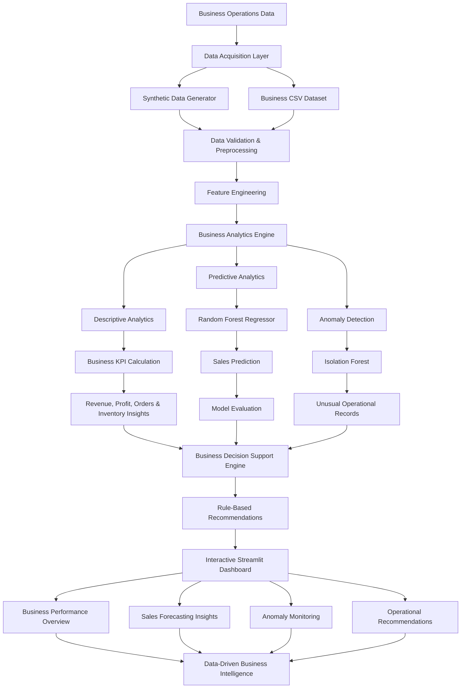
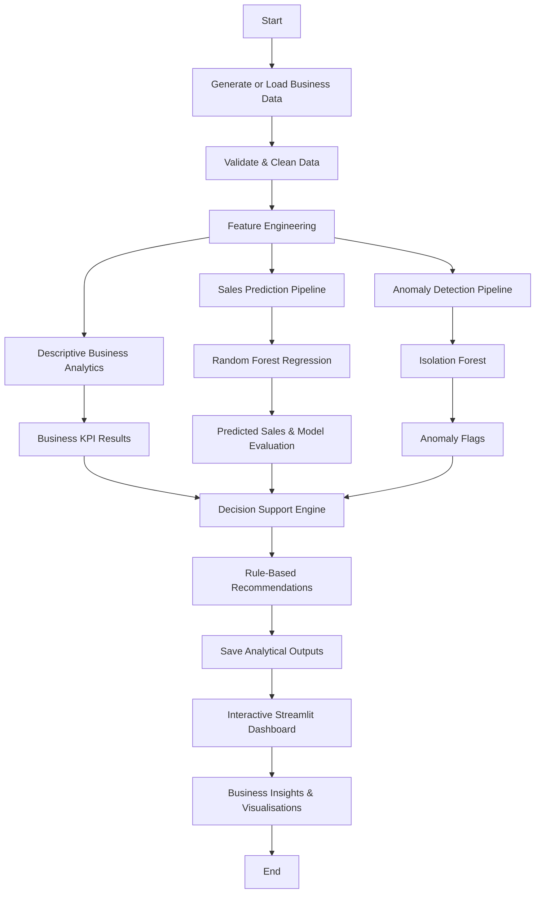

# AI-Powered Business Operations Intelligence and Predictive Decision Support System

## Intelligent Business Analytics, Sales Forecasting and Operational Risk Monitoring

An end-to-end **Business Operations Intelligence System** that integrates data science, machine learning, anomaly detection, and rule-based decision support to transform operational business data into meaningful insights. The platform combines descriptive analytics, Random Forest-based sales prediction, Isolation Forest-based anomaly detection, and business recommendation logic to analyse operational performance and identify potential areas requiring attention.

An interactive Streamlit dashboard brings together business KPIs, sales trends, predictive results, anomaly records, and practical recommendations in a unified analytical environment.

> **Data Disclaimer:** This project uses a synthetic business operations dataset generated for educational and portfolio demonstration purposes. It does not represent an actual company, customer, employee, supplier, or internship assignment. Synthetic findings must not be presented as verified business performance. Real-world application requires appropriately authorised business data and independent validation.

---

## Project Overview

Business operations generate information across multiple functional areas, including:

- Sales and revenue.
- Product and inventory management.
- Customer orders and returns.
- Marketing expenditure.
- Supplier performance.
- Workforce utilisation.
- Profitability and operational efficiency.

When these datasets are analysed separately, identifying relationships between operational performance and potential business risks can become difficult.

This project demonstrates how an integrated analytics framework can combine operational data, predictive modelling, and anomaly detection to support more informed business decisions.

## Project Objectives

- Develop a unified business operations analytics workflow.
- Generate or process structured operational business data.
- Perform data cleaning, validation, and feature engineering.
- Calculate business performance indicators and operational KPIs.
- Analyse sales trends across products, categories, and regions.
- Predict sales using a Random Forest regression model.
- Identify unusual operational patterns using Isolation Forest.
- Generate interpretable, rule-based business recommendations.
- Visualise analytical results through an interactive dashboard.
- Export processed datasets, predictions, and analytical reports.

## Key Features

- **Business Data Generation:** Creates synthetic operational records for demonstration.
- **Data Preprocessing:** Handles missing values, data validation, and feature preparation.
- **Descriptive Analytics:** Calculates revenue, profit-related indicators, orders, returns, and inventory KPIs.
- **Business Trend Analysis:** Examines daily sales, regional performance, and category-level trends.
- **Sales Prediction:** Uses Random Forest regression to estimate sales based on calendar and operational features.
- **Anomaly Detection:** Applies Isolation Forest to identify unusual combinations of operational indicators.
- **Business Recommendations:** Generates rule-based suggestions from configured KPI conditions.
- **Model Evaluation:** Measures predictive performance using MAE, RMSE, and R².
- **Interactive Dashboard:** Presents business intelligence, model results, and operational insights.
- **Automated Outputs:** Saves processed datasets, model artifacts, prediction results, and analytical reports.

---

## System Architecture

The system follows a modular business intelligence architecture that transforms raw operational data into performance indicators, predictive insights, anomaly flags, and decision-support recommendations.

The architecture is organised into eight major layers:

1. Business Data Acquisition and Generation
2. Data Validation and Preprocessing
3. Feature Engineering
4. Descriptive Business Analytics
5. Predictive Sales Analytics
6. Operational Anomaly Detection
7. Rule-Based Decision Support
8. Dashboard Visualisation and Reporting

### 1. Overall System Architecture



### 2. Architecture Components

| Architecture Layer | Components | Responsibility |
|---|---|---|
| Data Acquisition | CSV loader, synthetic data generator | Loads or generates structured business records. |
| Data Validation | Schema and quality checks | Checks data types, missing values, and consistency. |
| Preprocessing | Cleaning and transformation | Prepares operational data for analytical processing. |
| Feature Engineering | Calendar and operational features | Creates relevant predictors for business analysis. |
| Descriptive Analytics | KPI calculations and trend analysis | Measures operational and financial performance. |
| Predictive Analytics | Random Forest Regressor | Estimates future or target-period sales, according to the configured prediction design. |
| Anomaly Detection | Isolation Forest | Identifies unusual operational observations. |
| Decision Support | Configurable business rules | Converts analytical indicators into advisory recommendations. |
| Presentation | Streamlit dashboard | Displays KPIs, trends, predictions, and anomalies. |
| Output Management | CSV exports and model artifacts | Stores analytical results and trained models. |

### 3. Detailed Data Processing Architecture

**Stage 1 — Business Data Acquisition**

The system accepts structured operational data through:

- Synthetic business data generation.
- Existing business CSV datasets.
- Configured local data sources.

The demonstration dataset combines sales, inventory, returns, marketing, supplier, and workforce information.

**Stage 2 — Data Validation and Preprocessing**

The incoming records are checked and prepared before analytical processing.

Operations include:

- Data type validation.
- Missing-value identification and handling.
- Duplicate record checks.
- Date conversion and chronological ordering.
- Numerical feature validation.
- Categorical variable preparation.
- Business-field consistency checks.

**Stage 3 — Feature Engineering**

Raw operational records are transformed into analytical features.

Potential engineered features include:

| Feature Group | Examples |
|---|---|
| Calendar Features | Year, month, day, weekday, weekend indicator |
| Sales Features | Lagged sales, rolling sales averages, sales changes |
| Inventory Features | Inventory levels, inventory coverage indicators |
| Marketing Features | Marketing expenditure and related ratios |
| Operational Features | Workforce hours, supplier delays, returns |
| Profitability Features | Profit margin and estimated profit indicators |

Feature availability must match the actual implementation. Lagged and rolling features must be calculated using historical information only to avoid future-data leakage.

**Stage 4 — Descriptive Business Analytics**

The descriptive analytics engine calculates business performance indicators.

Outputs can include:

- Total revenue.
- Estimated profit.
- Total orders.
- Average order value.
- Return rate.
- Inventory summaries.
- Regional sales performance.
- Category-level sales performance.
- Marketing expenditure summaries.
- Supplier delay analysis.

**Stage 5 — Predictive Sales Analytics**

The Random Forest Regressor estimates sales using selected calendar and operational features.

The predictive workflow includes:

1. Select the target sales variable.
2. Identify relevant predictor features.
3. Prepare chronological training and testing subsets.
4. Fit preprocessing transformations on training data.
5. Train the Random Forest regression model.
6. Generate predictions on held-out observations.
7. Evaluate predictions using regression metrics.

Outputs include actual-versus-predicted comparisons, sales estimates, and model evaluation metrics.

The model is a regression model. Whether it forecasts genuinely future sales depends on the target construction, temporal split, and availability of predictor information at forecast time.

**Stage 6 — Operational Anomaly Detection**

Isolation Forest analyses selected operational features to identify unusual combinations of business measurements.

Potential inputs include:

- Sales.
- Inventory levels.
- Returns.
- Marketing expenditure.
- Workforce hours.
- Supplier delay days.
- Profit margin.

The model produces anomaly indicators that can be reviewed by business stakeholders.

An anomaly is an unusual statistical observation, not proof of fraud, operational failure, or poor employee performance.

**Stage 7 — Business Decision Support**

The recommendation engine evaluates selected business indicators and configured thresholds.

It converts analytical findings into understandable suggestions.

Examples:

- Unusual sales decline → Review category and regional sales trends.
- Low inventory indicator → Review replenishment requirements.
- Elevated return rate → Investigate product or fulfilment patterns.
- Supplier delays → Review supplier delivery performance.
- Unusual marketing expenditure → Examine campaign spending efficiency.
- Low profitability indicator → Review cost and pricing assumptions.

Recommendations are advisory and require human review.

**Stage 8 — Dashboard and Reporting**

The Streamlit dashboard integrates descriptive, predictive, and anomaly analytics.

It presents:

- Business KPI summaries.
- Revenue and profit trends.
- Category and regional comparisons.
- Sales predictions and model performance.
- Anomaly records.
- Rule-based recommendations.
- Downloadable analytical outputs.

### 4. End-to-End System Workflow



---

## Dataset Information

**Dataset Type:** Synthetic business operations dataset.

The demonstration dataset is designed to represent selected business activities across sales, inventory, returns, marketing, suppliers, and workforce operations.

### Dataset Fields

| Field | Description |
|---|---|
| `date` | Business observation date |
| `region` | Sales region |
| `product_category` | Product category |
| `sales` | Revenue for the observation |
| `units_sold` | Number of units sold |
| `inventory_level` | Available inventory units |
| `customer_orders` | Number of customer orders |
| `returns` | Number of returned units |
| `marketing_spend` | Marketing expenditure |
| `workforce_hours` | Operational workforce hours |
| `supplier_delay_days` | Supplier delivery delay in days |
| `profit_margin` | Profit margin ratio |

The exact feature definitions, units, and generation rules should be documented in the data-generation module.

### Suggested Data Location

```text
data/
└── demo_business_data.csv
```

---

## Methodology

### 1. Descriptive Analytics

The system evaluates business performance using operational and financial indicators.

**Key KPIs:**

| KPI | Description |
|---|---|
| Total Revenue | Aggregate sales revenue. |
| Estimated Profit | Revenue-based profit estimate, subject to the margin definition. |
| Total Orders | Aggregate customer orders. |
| Average Order Value | Revenue divided by order count. |
| Return Rate | Returned units relative to units sold. |
| Inventory Level | Available inventory summary. |
| Marketing Spend | Aggregate marketing expenditure. |
| Supplier Delay | Summary of supplier delivery delays. |

**Example KPI calculations**

Total Revenue:

\[
Revenue=\sum_{i=1}^{n}Sales_i
\]

Average Order Value:

\[
AOV=\frac{Total\ Revenue}{Total\ Orders}
\]

Return Rate:

\[
Return\ Rate=
\frac{Total\ Returned\ Units}{Total\ Units\ Sold}\times100
\]

If `profit_margin` represents a ratio, an estimated profit calculation can be:

\[
Estimated\ Profit=\sum_{i=1}^{n}(Sales_i\times ProfitMargin_i)
\]

These formulas assume consistent units and a clearly defined meaning for each dataset field.

### 2. Predictive Analytics — Random Forest Regression

<badge color="success">Supervised Learning</badge>

Random Forest Regression is used to estimate sales from historical and operational features.

**Potential input features:**

- Calendar variables.
- Historical sales.
- Product category.
- Region.
- Inventory level.
- Marketing expenditure.
- Supplier delays.
- Other available operational predictors.

**Model outputs:**

- Predicted sales values.
- Actual-versus-predicted comparisons.
- Regression evaluation metrics.

**Evaluation metrics:**

| Metric | Purpose |
|---|---|
| MAE | Measures average absolute prediction error. |
| RMSE | Penalises larger prediction errors more strongly. |
| R² | Measures explained variance relative to a baseline. |

Mean Absolute Error:

\[
MAE=\frac{1}{n}\sum_{i=1}^{n}|y_i-\hat{y}_i|
\]

Root Mean Squared Error:

\[
RMSE=\sqrt{\frac{1}{n}\sum_{i=1}^{n}(y_i-\hat{y}_i)^2}
\]

Coefficient of Determination:

\[
R^2=1-\frac{\sum_{i=1}^{n}(y_i-\hat{y}_i)^2}
{\sum_{i=1}^{n}(y_i-\bar{y})^2}
\]

A chronological holdout split is used to evaluate time-dependent business observations. Any feature used for prediction must be available at the time the prediction would be made.

### 3. Anomaly Detection — Isolation Forest

<badge color="info">Unsupervised Learning</badge>

Isolation Forest identifies observations that differ from the broader operational data distribution.

**Potential input features:**

- Sales.
- Inventory levels.
- Returns.
- Marketing expenditure.
- Workforce hours.
- Supplier delay days.
- Profit margin.

**Workflow:**

1. Select relevant operational features.
2. Handle missing values.
3. Prepare the numerical feature matrix.
4. Fit the Isolation Forest model.
5. Generate anomaly indicators.
6. Review flagged records.
7. Visualise anomaly distribution.

**Output:**

- Normal observation indicator.
- Anomaly indicator.
- Flagged operational records.
- Anomaly summaries and visualisations.

Anomaly detection identifies statistical irregularities, not confirmed business problems.

### 4. Rule-Based Business Recommendations

The recommendation engine converts selected business indicators into advisory actions.

| Business Condition | Suggested Recommendation |
|---|---|
| Sales decline | Review sales trends and regional performance. |
| Low inventory | Examine stock replenishment requirements. |
| Elevated return rate | Investigate product quality and fulfilment patterns. |
| Supplier delays | Review supplier delivery performance. |
| High marketing expenditure | Evaluate campaign spending and outcomes. |
| Unusual operational records | Investigate flagged observations. |

The rules and thresholds should be configurable and documented. Recommendations do not automatically execute operational decisions.

---

## Technology Stack

| Category | Technologies |
|---|---|
| Programming Language | Python |
| Data Processing | Pandas, NumPy |
| Machine Learning | Scikit-learn |
| Regression Algorithm | Random Forest Regressor |
| Anomaly Detection | Isolation Forest |
| Data Visualisation | Matplotlib, Seaborn, Plotly |
| Dashboard | Streamlit |
| Data Format | CSV |
| Model Persistence | Joblib |
| Development Environment | Jupyter Notebook, VS Code |
| Version Control | Git, GitHub |

---

## Repository Structure

```text
ai_business_operations_intelligence/
│
├── app.py
├── requirements.txt
├── README.md
├── .gitignore
│
├── data/
│   └── demo_business_data.csv
│
├── models/
│   └── README.md
│
├── results/
│   └── README.md
│
└── src/
    ├── __init__.py
    ├── data_generator.py
    ├── preprocessing.py
    ├── analytics.py
    ├── modeling.py
    ├── recommendations.py
    └── pipeline.py
```

*This structure reflects the supplied project design. Update it if the actual repository contains additional files or different locations.*

---

## Installation and Setup

### Prerequisites

- Python 3.10 or newer.
- pip package manager.
- Git (optional).

### 1. Clone the Repository

```bash
git clone <repository-url>
cd ai_business_operations_intelligence
```

### 2. Create a Virtual Environment

```bash
python -m venv venv
```

**Windows:**

```bash
venv\Scripts\activate
```

**macOS / Linux:**

```bash
source venv/bin/activate
```

### 3. Install Dependencies

```bash
pip install -r requirements.txt
```

### 4. Generate Synthetic Business Data

```bash
python -m src.data_generator
```

This command assumes the data generator provides a module execution entry point. Adjust it to the actual implementation if necessary.

### 5. Execute the Analytics Pipeline

```bash
python -m src.pipeline
```

The pipeline is designed to perform:

- Data preprocessing.
- Feature engineering.
- Descriptive analytics.
- Sales model training.
- Anomaly detection.
- Business recommendation generation.
- Model evaluation.
- Analytical output generation.

### 6. Launch the Streamlit Dashboard

```bash
streamlit run app.py
```

Open the local URL displayed in the terminal to explore the business operations intelligence dashboard.

---

## Generated Outputs

The project is designed to generate the following outputs:

| Output | Description |
|---|---|
| Demo Business Dataset | Synthetic operational transaction and KPI records. |
| Cleaned Dataset | Processed business data. |
| Sales Predictions | Actual and predicted sales values. |
| Anomaly Records | Operational observations flagged by Isolation Forest. |
| Business Recommendations | Rule-based decision-support suggestions. |
| Model Metrics | MAE, RMSE, and R² evaluation results. |
| Trained Sales Model | Saved Random Forest regression artifact. |
| Anomaly Model | Saved Isolation Forest artifact. |

Actual filenames and save locations should match the pipeline implementation.

---

## Dashboard Sections

The interactive Streamlit dashboard is organised into five analytical areas.

| Dashboard Section | Description |
|---|---|
| Overview | Revenue, estimated profit, orders, returns, and inventory KPIs. |
| Business Trends | Daily sales, category comparisons, and regional performance. |
| Sales Prediction | Model evaluation and actual-versus-predicted visualisations. |
| Anomaly Monitoring | Unusual operational records identified by Isolation Forest. |
| Recommendations | Practical rule-based suggestions based on selected business indicators. |

### Suggested Dashboard Screenshots

For a strong GitHub presentation, include genuine screenshots of:

1. **Business Intelligence Overview** – revenue, profit, orders, returns, and inventory KPI cards.
2. **Business Trends Dashboard** – daily sales and category/region comparisons.
3. **Sales Prediction Results** – actual-versus-predicted chart and model metrics.
4. **Anomaly Monitoring** – flagged records and anomaly visualisations.
5. **Business Recommendations** – generated suggestions and the conditions triggering them.

---

## Evaluation and Validation

### Sales Prediction

Evaluate the Random Forest regression model using:

- MAE.
- RMSE.
- R².

Use a chronological train/test split where time dependence is present.

### Anomaly Detection

When ground-truth anomaly labels are available, evaluate using:

- Precision.
- Recall.
- F1-score.
- Confusion matrix.

Without labels, report the number and proportion of flagged records and review them manually.

### Recommendation Validation

Assess recommendations based on:

- Correct triggering of configured rules.
- Relevance of the suggested action.
- Consistency of thresholds.
- Business stakeholder review.
- Suitability for the operational context.

### Results Reporting

Do not publish invented model scores or business improvements.

Record:

- Dataset version and generation settings.
- Training and test date ranges.
- Feature definitions.
- Model parameters.
- Random seed.
- MAE, RMSE, and R².
- Anomaly detection configuration.
- Recommendation rules and thresholds.

---

## Important Limitations

- The demonstration dataset is synthetic and does not represent actual business operations.
- Model performance on synthetic data does not establish real-world predictive value.
- Sales prediction quality depends on sufficient historical observations and feature availability.
- Synthetic relationships may make model results unrealistically simple.
- Anomaly detection can generate false positives and false negatives.
- Anomalies are not automatically evidence of fraud, operational failure, or employee underperformance.
- Business recommendations are rule-based and depend on configured thresholds.
- Estimated profit depends on the definition and consistency of the profit-margin field.
- This project is a portfolio demonstration, not a production-ready enterprise decision-support platform.

## Responsible Use

- Use the system for educational, research, and authorised business analytics purposes.
- Protect sensitive, confidential, and personally identifiable business information.
- Ensure that uploaded datasets are authorised for analysis.
- Validate predictive outputs before using them in business planning.
- Review anomaly flags rather than treating them as confirmed operational issues.
- Avoid using model outputs as the sole basis for employee evaluation or consequential business decisions.
- Monitor model reliability and potential biases.
- Maintain human oversight and follow applicable data protection requirements.

---

## Future Enhancements

- Integration with authorised ERP and CRM data sources.
- Real-time business data ingestion.
- Advanced sales forecasting using XGBoost and LightGBM.
- Time-series forecasting using LSTM models.
- Predictive inventory and demand planning.
- Supplier performance risk analytics.
- Automated KPI threshold alerts.
- Explainable AI using SHAP.
- Model drift and performance monitoring.
- Role-based dashboard access.
- REST API integration using FastAPI.
- Cloud-based deployment and scalable data processing.
- Automated business report generation.

## Conclusion

The AI-Powered Business Operations Intelligence and Predictive Decision Support System demonstrates how descriptive analytics, predictive modelling, anomaly detection, and rule-based recommendations can be integrated into a unified business intelligence workflow.

By combining Random Forest sales prediction, Isolation Forest anomaly detection, operational KPI analysis, and business recommendation logic, the platform provides an educational framework for understanding business performance and identifying areas requiring further investigation.

The project highlights how data-driven analytics can support operational awareness and informed decision-making while emphasising data quality, model validation, responsible interpretation, and human oversight.

---

## Author

**Mohamed Riyaz S.**  
Integrated M.Tech – Computer Science and Engineering (Business Analytics)  
Vellore Institute of Technology (VIT), Chennai
